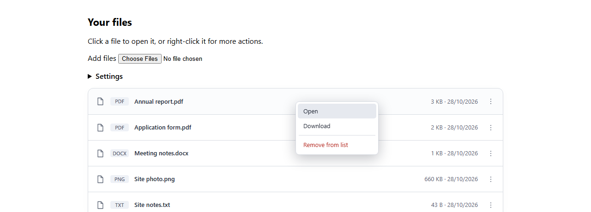
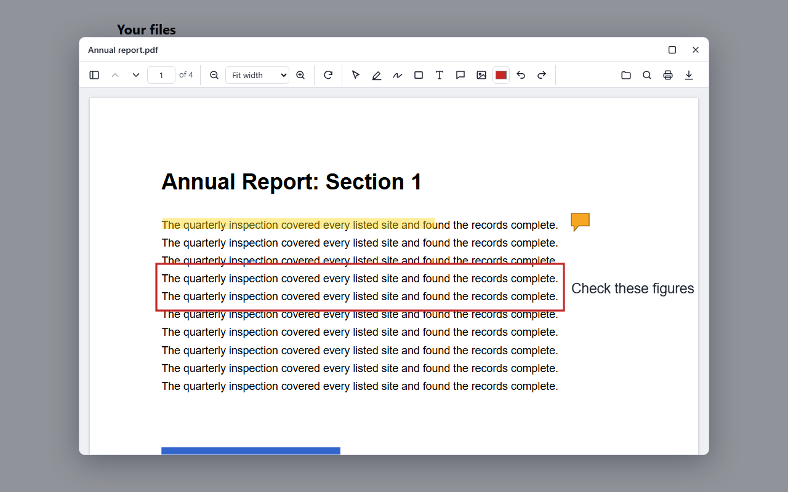
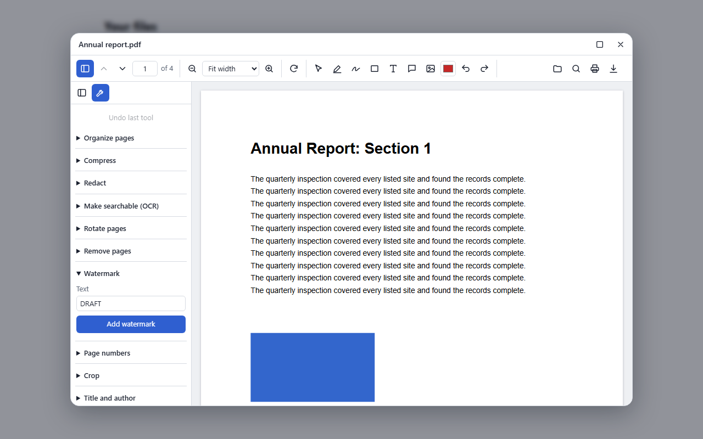
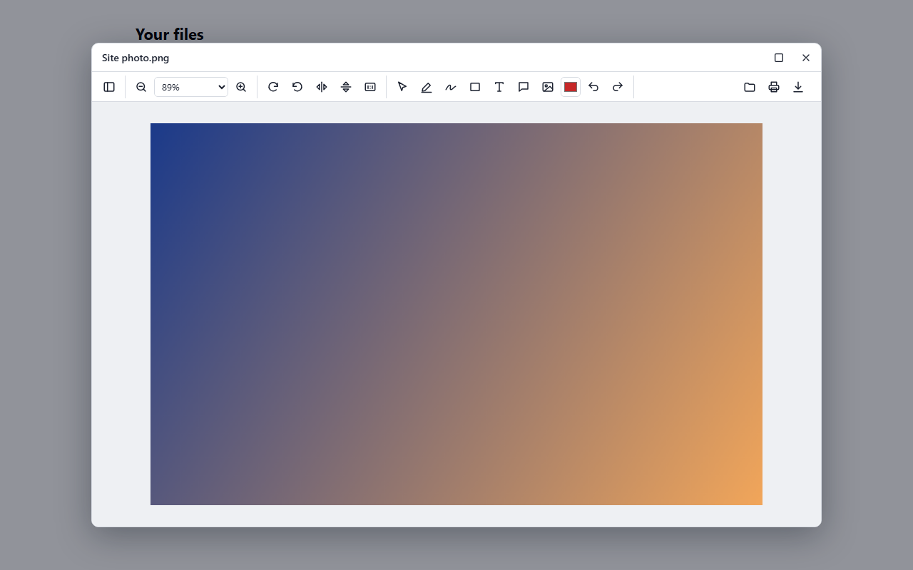
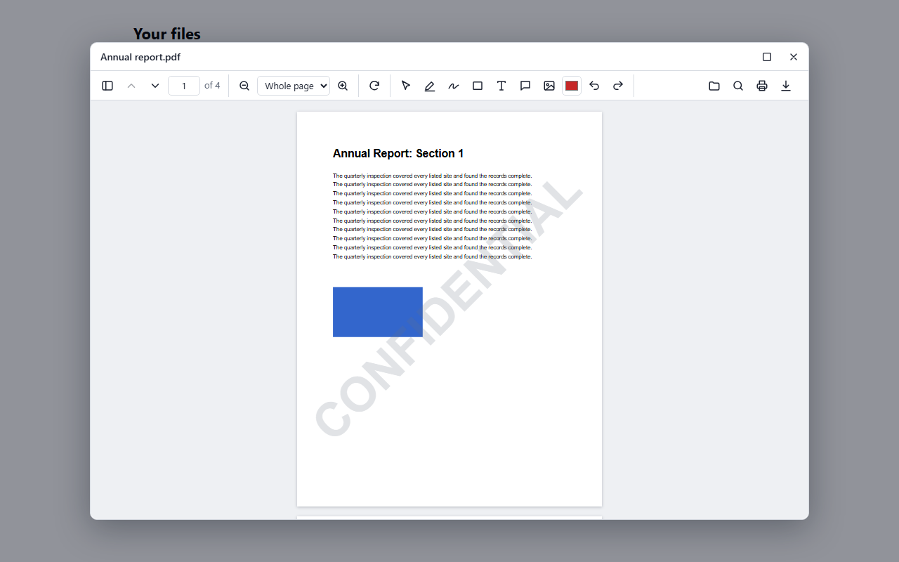
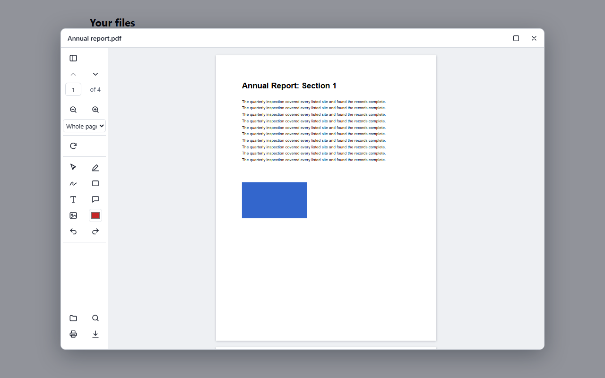
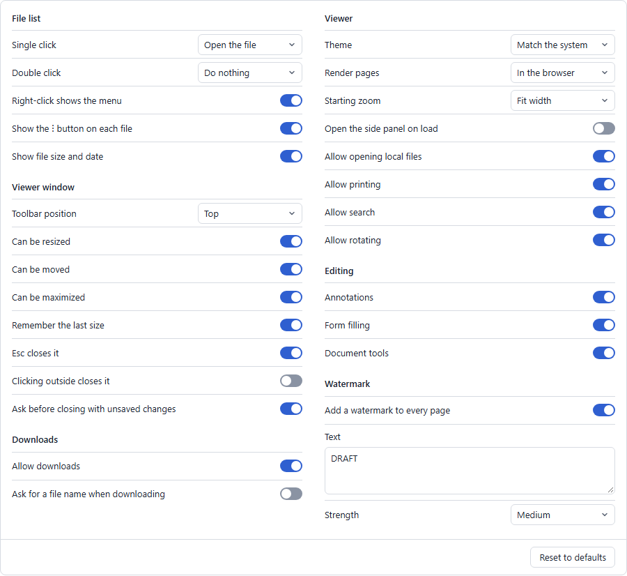

# Document Suite Viewer

An open-source PDF and image viewer and editor for React, Vue, Angular and plain JavaScript.

**[Try it live](https://kartik-ramachandran.github.io/PDFSuite/#try)** · **[Add it to your app](#add-it-to-your-app)** · **[All settings](#settings)**

- **In your app:** a file list with a right-click menu, and a window people can move and resize
- **Viewing:** zoom, thumbnails, search, selectable text, rotation, printing and download
- **Images:** PNG, JPEG, GIF, WebP, BMP, SVG, AVIF and ICO files open automatically, with the same toolbar, annotations and document tools as PDFs, plus pan and flip
- **Editing (optional):** highlights, drawing, text, comments, pictures and form filling, all saved into the PDF
- **Document tools (with the API):** organize pages, redact, compress, OCR, watermark, convert and more
- **Two rendering modes:** in the browser, so documents stay on the device, or on your server
- **Other formats:** with the API, it also opens Word, Excel, PowerPoint, HTML, Markdown and text files
- **Settings for everything:** clicks, toolbar position, watermark and more, set in code or on a ready-made screen, and saved in the browser or on your server

## Screenshots

| | |
|---|---|
|  |  |
| **File list** with a right-click menu | **Viewer window** with annotations |
|  |  |
| **Document tools**, with the API | **Images** open automatically |
|  |  |
| **Watermark** setting | **Toolbar** on the left, set in settings |

All of these use generated sample files. To retake them, follow the steps at the top of [`scripts/take-screenshots.mjs`](scripts/take-screenshots.mjs).

## Add it to your app

This takes a few minutes, and PDFs and images work straight away with no server. These exact steps are tested in new React, Vue, Angular and plain JavaScript apps.

**[Try the viewer live](https://kartik-ramachandran.github.io/PDFSuite/#try) first**, with nothing to install.

### 1. Install the packages

You always need `viewer`, then add `editor` for annotations and forms, and the package for your framework.

The packages aren't on npm yet, so they install from the [GitHub release](https://github.com/kartik-ramachandran/PDFSuite/releases/latest). Your `package.json` then points at those files, and everything else works as normal.

```bash
RELEASE=https://github.com/kartik-ramachandran/PDFSuite/releases/download/v0.1.0

# Use pdf-suite-vue or pdf-suite-angular for those frameworks. For plain JavaScript, leave off the last file.
npm install $RELEASE/pdf-suite-viewer-0.1.0.tgz $RELEASE/pdf-suite-editor-0.1.0.tgz $RELEASE/pdf-suite-react-0.1.0.tgz
```

In PowerShell, set it with `$RELEASE="https://..."`, and the `npm install` line works as it is. The commands on the [website](https://kartik-ramachandran.github.io/PDFSuite/#install) have the addresses written out in full, ready to copy.

| Package | Purpose |
|---|---|
| `@pdf-suite/viewer` | The viewer, with no framework needed |
| `@pdf-suite/editor` | Optional annotations, form filling, watermarks and document tools |
| `@pdf-suite/react`, `@pdf-suite/vue`, `@pdf-suite/angular` | Framework components |

Tested with React 19, Vue 3.5 and Angular 22. There's no stylesheet to import, because the viewer brings its own styles inside a Shadow DOM, so your app's CSS and the viewer's can't affect each other.

**Bundle size:** about 225 KB gzipped for the viewer, plus about 370 KB for the PDF.js worker, which loads in the background. The code that writes PDFs, about 170 KB, only loads when someone exports annotations or a watermark.

### 2. Show your files

**React**

```tsx
import { createEditorPlugin } from '@pdf-suite/editor';
import { FileList, type FileItem } from '@pdf-suite/react';

const files: FileItem[] = [
  { id: 'report', name: 'report.pdf', source: '/report.pdf' },
  { id: 'photo', name: 'photo.png', source: '/photo.png' },
];

// Keep this outside the component, so it isn't rebuilt on every render.
const viewer = { plugins: [createEditorPlugin()] };

export function App() {
  return <FileList files={files} viewer={viewer} />;
}
```

**Vue**

```vue
<script setup lang="ts">
import { createEditorPlugin } from '@pdf-suite/editor';
import { FileList } from '@pdf-suite/vue';
import { markRaw } from 'vue';

const files = [
  { id: 'report', name: 'report.pdf', source: '/report.pdf' },
  { id: 'photo', name: 'photo.png', source: '/photo.png' },
];

// markRaw stops Vue from wrapping the plugin in a reactive proxy.
const options = markRaw({ viewer: { plugins: [createEditorPlugin()] } });
</script>

<template>
  <FileList :files="files" :options="options" />
</template>
```

**Angular**

```ts
import { Component } from '@angular/core';
import { createEditorPlugin } from '@pdf-suite/editor';
import { FileListComponent, type FileItem } from '@pdf-suite/angular';

@Component({
  selector: 'app-root',
  imports: [FileListComponent],
  template: '<pdf-suite-file-list [files]="files" [options]="options" />',
})
export class AppComponent {
  readonly files: FileItem[] = [
    { id: 'report', name: 'report.pdf', source: '/report.pdf' },
    { id: 'photo', name: 'photo.png', source: '/photo.png' },
  ];

  readonly options = { viewer: { plugins: [createEditorPlugin()] } };
}
```

**Plain JavaScript**

```js
import { createFileList } from '@pdf-suite/viewer';
import { createEditorPlugin } from '@pdf-suite/editor';

createFileList(document.getElementById('files'), {
  files: [
    { id: 'report', name: 'report.pdf', source: '/report.pdf' },
    { id: 'photo', name: 'photo.png', source: '/photo.png' },
  ],
  viewer: { plugins: [createEditorPlugin()] },
});
```

That's a working integration: clicking a file opens it in a window people can move, resize and annotate in. A URL on another domain needs CORS headers from that server, like anything fetched from a browser.

### 3. Use your own files

Files usually come from your backend. `source` can be a URL, the file's contents, or a function, so that a file is only fetched when someone opens it. If `source` needs a login, pass headers with it:

```ts
const response = await fetch('/api/documents');
const documents = await response.json();

const files = documents.map((document) => ({
  id: document.id,
  name: document.fileName,
  size: document.size,
  modified: document.updatedAt,
  source: { url: `/api/documents/${document.id}/content`, headers: { Authorization: `Bearer ${token}` } },
}));
```

### 4. Connect the API, if you need it

The API adds Word, Excel, PowerPoint, HTML, Markdown and text files, the document tools, server rendering and saved settings. Everything else works without it.

```bash
git clone https://github.com/kartik-ramachandran/PDFSuite.git
cd PDFSuite
docker compose up -d --build
```

Then tell the viewer where it is:

```ts
const viewer = { serviceUrl: 'http://localhost:8080', plugins: [createEditorPlugin()] };
```

Read [SECURITY.md](../SECURITY.md) before deploying the API, because it has no login or rate limits of its own.

### 5. Save edited files back to your app

The viewer gives you the finished file, including annotations and form values. Open the modal yourself to add your own save button or logic:

```ts
import { openViewerModal } from '@pdf-suite/viewer';
import { createEditorPlugin } from '@pdf-suite/editor';

const modal = openViewerModal({ title: file.name, plugins: [createEditorPlugin()] });
await modal.load(file.url, file.name);

async function save() {
  const bytes = await modal.viewer.getBytes();
  await fetch(`/api/documents/${file.id}/content`, { method: 'PUT', body: bytes });
  modal.viewer.markSaved(); // closing the window won't ask about unsaved changes
}
```

### 6. Adjust how it behaves

Everything from what a click does to where the toolbar sits is in the [settings](#settings), and the guides below cover each part in more detail.

### Just the viewer, without the file list

The viewer fills its parent element, so **give the parent a height**.

```tsx
import { PdfViewer } from '@pdf-suite/react';

<div style={{ height: '100vh' }}>
  <PdfViewer source="/report.pdf" />
</div>
```

In Vue it's `<PdfViewer source="/report.pdf" />` too, and in Angular `<pdf-suite-viewer source="/report.pdf" />`, with `PdfViewerComponent` in your component's `imports`. In plain JavaScript, use `createViewer(element, { source: '/report.pdf' })`.

Both can also be controlled from code, which the [API section](#api) covers.

### Need a hand?

Document Suite is free and open for anyone to use. If you get stuck, **[ask for setup help](https://github.com/kartik-ramachandran/PDFSuite/issues/new?template=setup-help.yml)**, and Kartik will get in touch.

## Viewing files in a modal

`FileList` shows your files. Clicking one opens it in a modal that can be resized from any edge or corner, moved by its title bar and maximized. Right-clicking shows a menu with **Open**, **Download** and your own actions.

```tsx
import { FileList } from '@pdf-suite/react';
import { createEditorPlugin } from '@pdf-suite/editor';

const files = [
  { id: '1', name: 'Report.pdf', source: '/files/1', size: 182000, modified: '2026-10-28' },
  // source can also be a function, so a file is only fetched when it's opened
  { id: '2', name: 'Photo.png', source: () => fetchFileUrl('2') },
];

<FileList
  files={files}
  viewer={{ serviceUrl: 'https://pdf.example.com', plugins: [createEditorPlugin()] }}
  menuItems={[{ id: 'delete', label: 'Delete', danger: true, separator: true, onSelect: (file) => remove(file.id) }]}
/>
```

The same component is `FileList` in Vue (`:files` and `:options`), and `<pdf-suite-file-list [files] [options]>` in Angular. What a click does, and everything else about how it behaves, is in the [settings](#settings).

### Using your own file list

If your app already has a list, call the functions from its click and right-click handlers:

```ts
import { openContextMenu, openViewerModal } from '@pdf-suite/viewer';

function openFile(file) {
  const modal = openViewerModal({ title: file.name, serviceUrl: 'https://pdf.example.com' });
  modal.load(file.url, file.name);
}

row.addEventListener('click', () => openFile(file));
row.addEventListener('contextmenu', (event) => {
  event.preventDefault();
  openContextMenu(event.clientX, event.clientY, [
    { id: 'open', label: 'Open', onSelect: () => openFile(file) },
    { id: 'delete', label: 'Delete', danger: true, separator: true, onSelect: () => remove(file) },
  ]);
});
```

To control a modal from a component instead, use `PdfViewerModal` in React and Vue, or `pdf-suite-viewer-modal` in Angular, with an `open` input and a close event.

### Modal options

| Option | Default | Description |
|---|---|---|
| `title` | the file name | Title bar text |
| `width`, `height` | most of the window, or the last size used | Initial size in pixels |
| `minWidth`, `minHeight` | `360`, `280` | Smallest allowed size |
| `onClose` | | Called after it closes |

Viewer options work here too, and the window's behaviour is in the [settings](#settings). Closing asks first if there are changes that haven't been downloaded. If your app saves documents itself, call `viewer.markSaved()` after sending `viewer.getBytes()` to your server. On small screens, the modal fills the screen.

## Opening documents

`source` accepts a URL, `Uint8Array`, `ArrayBuffer`, `Blob` or `File`, or base64, which suits documents that arrive inside a JSON response:

```js
viewer.load({ base64: response.data, name: 'report.pdf' });
viewer.load({ url: '/secure/report.pdf', headers: { Authorization: `Bearer ${token}` } });
```

The viewer checks each file's contents, not its name, and switches automatically:

| File | Opens in | Needs `serviceUrl` |
|---|---|---|
| PDF | The PDF viewer | Only in server mode |
| PNG, JPEG, GIF, WebP, BMP, SVG, AVIF, ICO | The image viewer, always in the browser | No |
| Word, Excel, PowerPoint, HTML, Markdown, text | The PDF viewer, after the API converts it | Yes |

`viewer.kind` tells you what's open (`'pdf'` or `'image'`), and the `documentLoaded` event includes it too. TIFF and HEIC can't be displayed in browsers, so the viewer explains that instead of opening them.

## Download names

Downloads keep the uploaded name, including capitals and any extra dots:

| What's open | What Download saves |
|---|---|
| A PDF or image | `Q3 Report.pdf`, under its uploaded name |
| An untouched Word, Excel, PowerPoint, HTML, Markdown or text file | The original file, such as `Q3 Report.docx` |
| A converted document with changes | A PDF with the same name, such as `Q3 Report.pdf` |
| An annotated image | A new PNG with the same name, such as `Photo.png` |

Turn on the `allowRename` [setting](#settings) to ask for a name first, starting from the uploaded one. The extension is kept, because it has to match the file's contents. `viewer.download('name.pdf')` skips the question, and the `downloaded` event tells your app which name was used.

## Adding editing tools

```ts
import { createEditorPlugin } from '@pdf-suite/editor';

const editor = createEditorPlugin();
const viewer = createViewer(element, {
  source: '/report.pdf',
  serviceUrl: 'https://pdf.example.com', // only needed for the document tools
  plugins: [editor],
});

// Get the finished PDF, including annotations and form values
const bytes = await viewer.getBytes();
const base64 = await viewer.getBase64();

// Save annotations separately, and restore them later
const saved = editor.annotations.getAnnotations();
editor.annotations.setAnnotations(saved);
```

After you add a comment or text, the tool turns itself off. Click a comment to read or edit it, or hover over it to read it. With the Select tool, double-click a comment or text to edit it, or drag anything to move it. Saving a comment or text with nothing in it deletes it.

In exported PDFs, drawings, highlights, text and pictures become page content, comments become real PDF comments, and form values stay in their fields. The same tools work on images, which export as a PNG at full resolution.

## Settings

All behaviour is controlled by one set of settings. Set them for your whole app, once, when it starts:

```ts
import { configureViewer } from '@pdf-suite/viewer'; // also exported by the React, Vue and Angular packages

configureViewer({
  clickAction: 'menu',       // a single click shows the menu instead of opening the file
  doubleClickAction: 'open',
  allowRename: true,
  closeOnBackdropClick: true,
});
```

Or for one component, which takes priority over the app-wide values:

```tsx
<FileList files={files} settings={{ clickAction: 'none', doubleClickAction: 'open' }} />
<PdfViewer source={file} settings={{ allowPrint: false }} />
```

File lists update straight away. Viewers read their settings when they're created, so changes apply to the next one opened.

| Setting | Default | Description |
|---|---|---|
| **File list** | | |
| `clickAction` | `'open'` | Single click: `'open'`, `'menu'` or `'none'` |
| `doubleClickAction` | `'none'` | Double click: `'open'`, `'menu'` or `'none'`. If both are set, a double click also runs the single click action first |
| `contextMenu` | `true` | Right-click shows the file's menu. When off, the browser's menu appears |
| `showMenuButton` | `true` | Shows the ⋮ button on each file |
| `showFileDetails` | `true` | Shows each file's size and date |
| **Viewer window** | | |
| `toolbarPosition` | `'top'` | Which side the toolbar is on: `'top'`, `'bottom'`, `'left'` or `'right'` |
| `modalResizable` | `true` | Can be resized from its edges and corners |
| `modalMovable` | `true` | Can be moved by its title bar |
| `modalMaximizable` | `true` | Can be maximized |
| `rememberModalSize` | `true` | Opens at the size the last one was left at |
| `closeOnEscape` | `true` | Esc closes it |
| `closeOnBackdropClick` | `false` | Clicking outside closes it |
| `confirmClose` | `true` | Asks before closing with unsaved changes |
| **Downloads** | | |
| `allowDownload` | `true` | Shows download buttons and menu items |
| `allowRename` | `false` | Asks what to call a file before downloading it |
| **Viewer** | | |
| `theme` | `'auto'` | `'auto'`, `'light'` or `'dark'` |
| `mode` | `'client'` | `'client'` renders in the browser. `'server'` has the API render pages |
| `initialZoom` | `'fit-width'` | A number, `'fit-width'` or `'fit-page'` |
| `sidebarOpen` | `false` | Opens the side panel on load |
| `allowOpen` | `true` | Shows the button for opening local files |
| `allowPrint` | `true` | Shows the print button |
| `allowSearch` | `true` | Shows search and enables its shortcut |
| `allowRotate` | `true` | Shows the rotate buttons |
| **Editing, with the editor plugin** | | |
| `annotations` | `true` | Annotation tools |
| `formFilling` | `true` | Fillable form fields |
| `documentTools` | `true` | The document tools panel |
| **Watermark, with the editor plugin** | | |
| `watermark` | `false` | Shows a watermark on every page, and adds it to prints and downloads |
| `watermarkText` | `'DRAFT'` | The text, which can have several lines. It also fills in the Watermark document tool |
| `watermarkOpacity` | `0.2` | How visible it is, from 0 to 1 |

**These settings shape the interface, and aren't security controls.** Turning off downloads or printing only removes the buttons, and the watermark is added in the browser. Anyone who can view a document in a browser can still save it without them, so protect sensitive documents on your server. To guarantee a watermark, add it with the API's `/api/pdf/watermark` route before the document reaches the browser.

With a watermark on, a converted file such as a Word document downloads as a PDF, because that's what can carry the watermark. Images download as PNG. Document tools that change the open document work on it without the watermark, so that it can't stack up.

The toolbar's position only changes through this setting. It can't be dragged to another side.

### A settings screen

`SettingsPanel` is a ready-made screen for all of these, which you can put on your app's settings page. Choices apply straight away.



```tsx
<SettingsPanel
  storageKey="my-app-viewer-settings"          // remembers choices in this browser
  exclude={['mode', 'allowDownload']}          // hides settings your users shouldn't change
  onChange={(settings) => saveToServer(settings)}
/>
```

In Vue, pass these through `:options`, and in Angular use `<pdf-suite-settings-panel [options]="...">`. Saved choices load when the panel appears, so if it's on a separate page, also call `configureViewer(JSON.parse(localStorage.getItem('my-app-viewer-settings') ?? '{}'))` when your app starts. To build your own screen, `SETTINGS_SCHEMA` describes every setting.

### Saving settings on the server

The PDF API can store settings, so that they follow people between browsers and you can change them for everyone from one place. Each set belongs to a `scope`, such as an app, team or user. The [API's documentation](../README.md#viewer-settings) covers setting up the server side, including who's allowed to change them.

There are two steps: **load** the settings when your app starts, and optionally give someone a way to **change** them.

If your app already stores settings for its users, you don't need the API for this. Save them from `SettingsPanel`'s `onChange`, and call `configureViewer(saved)` when your app starts.

### Loading settings in your app

Call `loadViewerSettings` before you start your app, so that the settings apply to the first file anyone opens. All of the framework packages export it too.

```ts
loadViewerSettings(options: {
  serviceUrl: string;                       // the PDF API
  scope?: string;                           // defaults to "default"
  serviceHeaders?: Record<string, string>;  // such as a gateway's auth token
}): Promise<PdfSuiteSettings>
```

**React**

```tsx
import { createRoot } from 'react-dom/client';
import { loadViewerSettings } from '@pdf-suite/react';
import { App } from './App';

loadViewerSettings({ serviceUrl: 'https://pdf.example.com', scope: 'team-a' })
  .catch((error) => console.warn('Using the default viewer settings.', error))
  .finally(() => createRoot(document.getElementById('root')!).render(<App />));
```

**Vue**

```ts
import { createApp } from 'vue';
import { loadViewerSettings } from '@pdf-suite/vue';
import App from './App.vue';

loadViewerSettings({ serviceUrl: 'https://pdf.example.com', scope: 'team-a' })
  .catch((error) => console.warn('Using the default viewer settings.', error))
  .finally(() => createApp(App).mount('#app'));
```

**Angular**

```ts
import { bootstrapApplication } from '@angular/platform-browser';
import { loadViewerSettings } from '@pdf-suite/angular';
import { AppComponent } from './app/app.component';

loadViewerSettings({ serviceUrl: 'https://pdf.example.com', scope: 'team-a' })
  .catch((error) => console.warn('Using the default viewer settings.', error))
  .finally(() => bootstrapApplication(AppComponent));
```

With plain JavaScript, import it from `@pdf-suite/viewer` and do the same before creating your viewer. Every `PdfViewer`, `FileList` and modal then uses these settings, with no further code.

**What to expect:**

- **If loading fails,** the promise rejects with a message saying why, and the viewer carries on with the settings it already had. That's what the `catch` above is for, so that a settings problem doesn't stop your app from starting.
- **If nothing is saved** for that scope, nothing changes.
- **Names or values the viewer doesn't recognize** are ignored, so a bad value can't break it.
- **The order of priority,** from lowest to highest, is the defaults, then `configureViewer` and `loadViewerSettings` in the order you call them, then a component's own `settings`. To stop the server from changing something on one component, set it on that component.

**Layering team and user settings.** Each load only changes the settings it contains, so a later load can adjust an earlier one:

```ts
await loadViewerSettings({ serviceUrl, scope: 'team-a' });
await loadViewerSettings({ serviceUrl, scope: `user-${user.id}` });
```

**Picking up changes while your app is open.** The server doesn't notify the browser, so changes arrive the next time you load. To refresh without a page reload, for example when someone comes back to the tab, reset first so that anything deleted on the server goes away too:

```ts
import { loadViewerSettings, resetViewerSettings } from '@pdf-suite/viewer';

document.addEventListener('visibilitychange', async () => {
  if (document.visibilityState !== 'visible') return;
  resetViewerSettings();
  await loadViewerSettings({ serviceUrl, scope }).catch(console.warn);
});
```

File lists update straight away. Viewers read their settings when they're created, so a viewer that's already open keeps its settings until the next one opens. `resetViewerSettings` also clears anything you set with `configureViewer`, so set those again if you use both.

### Changing settings from your app

There are three ways to change what's saved:

- **The settings screen:** give `SettingsPanel` the same details. It loads what's saved, saves about half a second after each change, and shows whether saving worked. Choices apply in that browser even if saving fails.

  ```tsx
  <SettingsPanel
    serviceUrl="https://pdf.example.com"
    scope="team-a"
    serviceHeaders={{ Authorization: `Bearer ${token}` }}
    exclude={['mode']}
  />
  ```

  In Vue, pass these through `:options`, and in Angular through `[options]`. Don't also set `storageKey`, or the two copies can disagree. **Reset to defaults** clears what's saved for that scope.

- **Your own code:** `saveViewerSettings({ serviceUrl, scope })` saves everything that differs from the defaults. To save specific values instead, pass them as the second argument.

- **Your server or a script:** call the [API](../README.md#saving-settings) directly, which suits settings that an administrator controls. People then only need `loadViewerSettings`, with no settings screen at all.

Saving only stores what differs from the defaults, so that a later change to a default still reaches people. This means that if your code sets `clickAction: 'menu'` and someone chooses the default of `'open'` on the settings screen, their choice isn't stored, and your code's value comes back on the next load. Avoid setting something in code if people can also change it.

### Giving each user their own settings

Deployed instances refuse changes until you set a write key, and that key can change any scope. A key in a browser can be read by anyone using it, so only send one from the browser for a trusted internal app.

For everything else, keep the key on your backend, and have the backend choose the scope from whoever is signed in. Point `serviceUrl` at your backend, which needs to handle `/api/settings/{scope}` below that address. As a sketch, in Express:

```js
app.all('/pdf/api/settings/:scope', requireLogin, express.json(), async (req, res) => {
  // Ignores the scope in the address, so people can only reach their own settings.
  const response = await fetch(`${PDF_API}/api/settings/user-${req.user.id}`, {
    method: req.method,
    headers: { 'Content-Type': 'application/json', Authorization: `Bearer ${SETTINGS_WRITE_KEY}` },
    body: req.method === 'PUT' ? JSON.stringify(req.body) : undefined,
  });
  res.status(response.status).type('application/json').send(await response.text());
});
```

```ts
await loadViewerSettings({ serviceUrl: `${location.origin}/pdf`, scope: 'me' });
```

A user id has to fit the scope format: letters, numbers, hyphens and underscores, up to 64 characters in total. Hash it first if it might not.

To try saving in the demos, add `?save=server` to the address.

## Options

These are set in code, on the viewer or on `openViewerModal`. Anything else is in the settings above.

| Option | Default | Description |
|---|---|---|
| `source` | | The document to open |
| `fileName` | from the source | Name used for downloads, and to detect non-PDF files |
| `settings` | | Settings for this viewer, on top of the app-wide ones |
| `serviceUrl` | | Base URL of the PDF API |
| `serviceHeaders` | | Headers sent with every API request, such as a gateway's auth token |
| `serviceTransport` | `'multipart'` | `'json'` sends documents to the API as base64 inside JSON |
| `toolbar` | `true` | Shows the toolbar |
| `plugins` | `[]` | Plugins such as the editor |
| `workerSrc` | bundled | Your own copy of the PDF.js worker. See below |
| `onPassword` | built-in prompt | Supplies passwords for protected PDFs |

In Vue and Angular, pass everything except `source`, `fileName` and `theme` through the `options` input. In all the wrappers, options are read once when the viewer is created.

## API

| Member | Description |
|---|---|
| `load(source, fileName?)` | Opens a document or image |
| `kind` | `'pdf'`, `'image'` or `null` |
| `goToPage(number)`, `page`, `pageCount` | Page navigation |
| `setZoom(value)`, `zoomIn()`, `zoomOut()`, `zoom` | Zoom |
| `rotateView()` | Turns the view, without changing the file |
| `search(text)`, `nextMatch()`, `previousMatch()` | Search |
| `getPageText(number)` | A page's text, with positions |
| `getBytes()`, `getBase64()` | The document, including changes |
| `download(fileName?)`, `print()` | Save or print. `download` resolves to `false` if the user cancels naming the file |
| `hasUnsavedChanges`, `markSaved()` | Tracks whether the document has changed since it was opened or saved |
| `setTheme(theme)` | Changes the theme |
| `on(event, listener)` | Subscribes to `documentLoaded`, `documentError`, `downloaded`, `pageChanged`, `zoomChanged`, `rotationChanged` or `searchChanged`, and returns an unsubscribe function |
| `destroy()` | Removes the viewer and frees its resources |

To reach this API, use a `ref` in React, a template ref's `viewer` in Vue, or the component's `viewer` property in Angular.

## Keyboard

| Key | Action |
|---|---|
| `Ctrl`/`⌘` + `F` | Search |
| `Page Up`, `Page Down`, `Home`, `End` | Move between pages |
| `+`, `-` | Zoom |
| `Ctrl`/`⌘` + `Z`, `Ctrl`/`⌘` + `Y` | Undo and redo annotations |
| `Delete` | Delete the selected annotation |
| `Esc` | Close search, or leave the current tool |

## Content Security Policy

The viewer needs `worker-src blob:` because it starts the PDF.js worker from a blob. If your policy doesn't allow that, host `pdf.worker.min.mjs` from `pdfjs-dist` yourself and set `workerSrc` to its URL. Images need `img-src blob:`.

## Choosing a mode

| | `client` | `server` |
|---|---|---|
| Needs a backend | Only for non-PDF files and document tools | Always |
| Where documents go | Stay on the device for PDFs | Uploaded to your server temporarily |
| Best for | Privacy and low hosting costs | Weak devices and very large files |
| Form fields drawn on the page | Yes | No |

## Known limits

- Document tools convert an image to a PDF first and open the result in the PDF viewer. **Undo last tool** brings the image back.
- An annotated image downloads as a new PNG, with comments drawn beside their icons, because images can't hold real comments. Rotating and flipping only change the view, as they do for PDFs.
- Rotated pages have no selectable text in server mode.
- Text that isn't in Western scripts is saved as a picture when exported.
- Fonts missing from a PDF fall back to system fonts, so those pages may look slightly different.
- Tested automatically in Chromium only, so check Firefox and Safari for your own use.

## License

[MIT](../LICENSE). See [THIRD_PARTY_NOTICES.md](../THIRD_PARTY_NOTICES.md) for dependencies.
