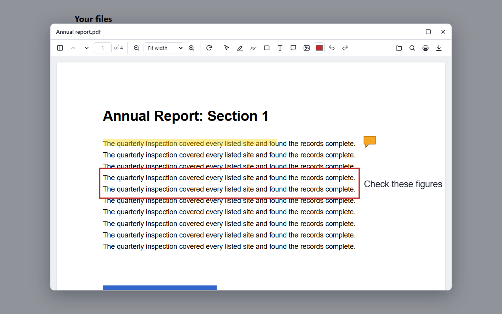

# @document-suite/viewer

An open-source PDF and image viewer for the browser, with a file list, a window people can move and resize, search, thumbnails and printing. It works with any framework, or none.



## Install

```bash
npm install @document-suite/viewer @document-suite/editor
```

## Use it in plain JavaScript

```js
import { createFileList } from '@document-suite/viewer';
import { createEditorPlugin } from '@document-suite/editor';

createFileList(document.getElementById('files'), {
  files: [
    { id: 'report', name: 'report.pdf', source: '/report.pdf' },
    { id: 'photo', name: 'photo.png', source: '/photo.png' },
  ],
  viewer: { plugins: [createEditorPlugin()] },
});
```

PDFs and images work straight away with no server. There's no stylesheet to import. Word, Excel and PowerPoint files and the document tools need the [Document Suite API](https://github.com/kartik-ramachandran/DocumentSuite#quick-start), which you run yourself.

## Learn more

- **[Try it live](https://kartik-ramachandran.github.io/DocumentSuite/#try)**, with nothing to install
- **[Integration guide](https://github.com/kartik-ramachandran/DocumentSuite/blob/main/viewer/README.md#add-it-to-your-app)** for React, Vue, Angular and plain JavaScript
- **[All settings](https://github.com/kartik-ramachandran/DocumentSuite/blob/main/viewer/README.md#settings)**

Document Suite is free and open for anyone to use, under the MIT License. If you'd like a hand setting it up, email kartikrama272@gmail.com.
