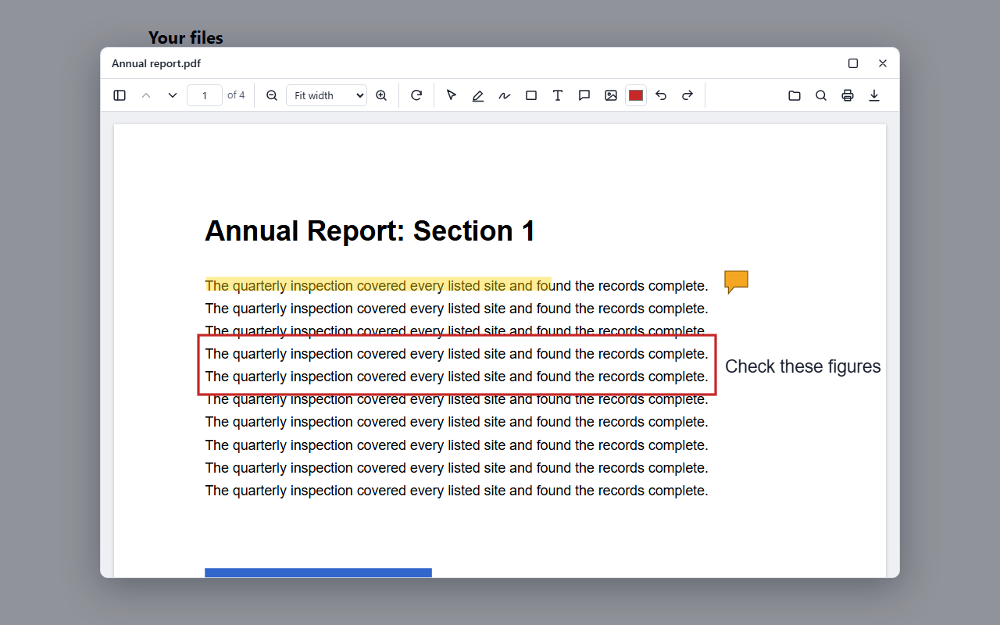

# @document-suite/editor

Adds editing to the [Document Suite viewer](https://www.npmjs.com/package/@document-suite/viewer): highlights, drawing, text, comments, pictures, signatures, form filling and watermarks, all saved into the PDF. With the Document Suite API, it also adds document tools such as compress, OCR, redact and convert.



## Install

```bash
npm install @document-suite/viewer @document-suite/editor
```

## Use it

```js
import { createViewer } from '@document-suite/viewer';
import { createEditorPlugin } from '@document-suite/editor';

const editor = createEditorPlugin();
const viewer = createViewer(document.getElementById('viewer'), {
  source: '/report.pdf',
  plugins: [editor],
});

// The finished PDF, including annotations and form values
const bytes = await viewer.getBytes();
```

The parent element needs a height, because the viewer fills it.

## Learn more

- **[Try it live](https://kartik-ramachandran.github.io/DocumentSuite/#try)**, with nothing to install
- **[Integration guide](https://github.com/kartik-ramachandran/DocumentSuite/blob/main/viewer/README.md#add-it-to-your-app)** for React, Vue, Angular and plain JavaScript
- **[All settings](https://github.com/kartik-ramachandran/DocumentSuite/blob/main/viewer/README.md#settings)**

Document Suite is free and open for anyone to use, under the MIT License. If you'd like a hand setting it up, email kartikrama272@gmail.com.
